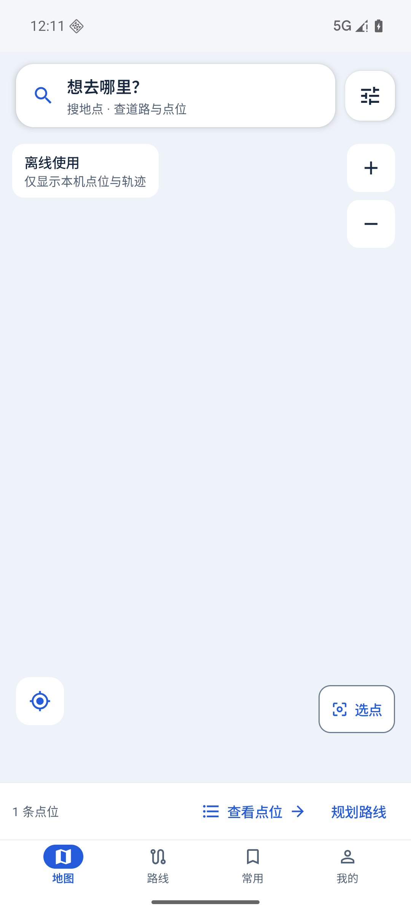
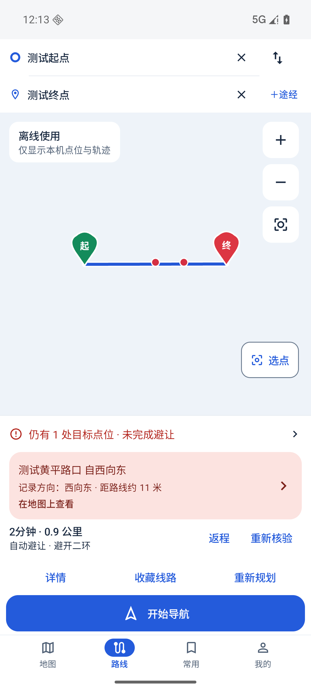
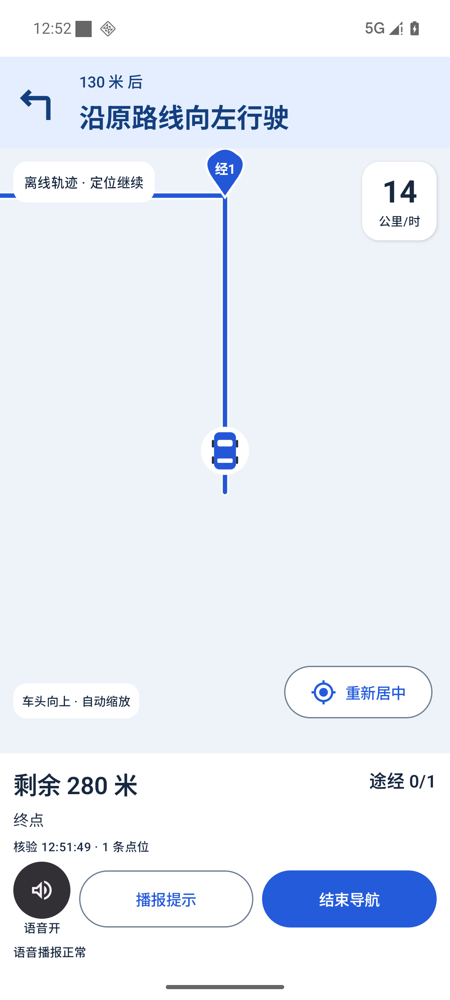
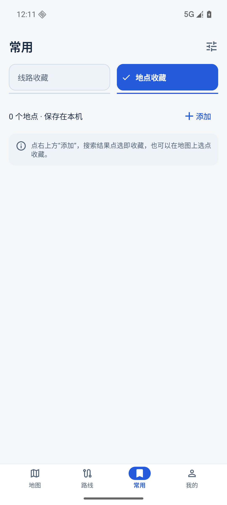
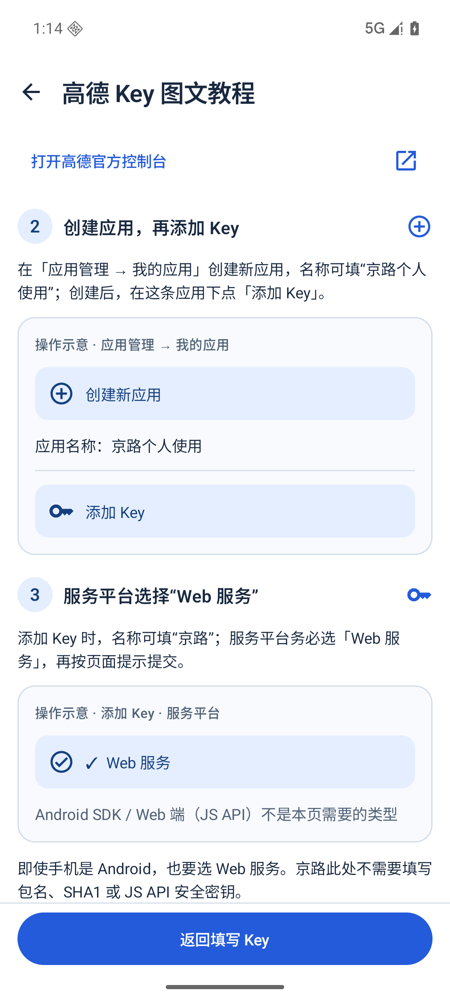

# 京路 Jinglu｜路线规划、点位避让与导航
京路是一款 Android 出行工具，支持地图点位查看、路线规划、点位避让、语音导航和常用路线收藏。适合需要结合点位信息比较北京六环、高速及普通道路出行方案的用户。
**[下载 Android APK](https://github.com/nvwapeace/jinglu-releases/releases/tag/android-v0.8.27-37)** · **[稳定频道与版本说明](https://github.com/nvwapeace/jinglu-releases/releases/tag/android-stable)** · **[意见反馈](https://jd9eltsa.jsjform.com/f/MSclVF)**
当前公开版：**0.8.27（37）**，最低支持 **Android 8.0（API 26）**。其他平台的安装包暂未在此提供。
> 下载时请选择 Assets 中后缀为 `.apk` 的文件。`Source code (zip / tar.gz)` 是 GitHub 自动生成的仓库快照，不能安装到手机。
## 京路能做什么
| 功能 | 使用方式 |
| --- | --- |
| 地图与点位 | 在地图上查看本机点位，搜索地点或手动选点，查看点位名称及方向信息。 |
| 路线规划与点位避让 | 设置起点、终点和途经点，比较路线；规划和核验会结合方向、道路归属及可用证据判断点位。 |
| 北京六环与高速出行 | 对比六环进出口接驳、高速与普通道路候选，结合完整路线查看距离、时间和剩余目标。 |
| 导航与语音 | 沿选定路线导航，显示转向、进度和途经点，支持语音提示及偏航后的重新规划。 |
| 常用路线与地点收藏 | 保存路线轨迹与地点，恢复收藏后重新核验；完整路线缩略图在本机缓存并随路线更新。 |
| 数据与问题排查 | 区分来源更新时间和本机同步时间，支持本机备份，以及有空间上限、由用户控制的导航和异常日志。 |
| 更新与反馈 | 在 App 内检查 GitHub 版本、下载校验并交给系统安装；通过反馈表单反馈问题。 |
如果仍有目标点位未能绕开，App 会展示具体点位，开始导航前需再次确认。路线及点位判断取决于数据和道路条件，不承诺每次都能完全绕开；实际出行请以道路标志和现行通行要求为准。
## 界面预览
下图来自专用模拟器的测试场景，使用测试点位和轨迹；离线画面仅展示点位与路线，联网底图需在 App 中按需开启。图中距离、方向和速度为测试数据。
| 地图与点位 | 路线核验 |
| :---: | :---: |
|  |  |
| 导航与语音 | 常用地点收藏 |
| :---: | :---: |
|  |  |
## 安装与首次使用
1. 打开上方 **下载 Android APK**，在 Assets 中下载 `.apk` 文件，并按 Android 系统提示安装。
2. 首次进入阅读隐私说明，再按需要开启联网和定位权限。导航建议授予精确定位权限。
3. 在启动弹窗或“我的 → 地图与隐私设置”中填写**你自己的高德 Web 服务 Key**。没有 Key 时，可先阅读 App 内的四步图文教程。
4. 在“路线”中设置起点、终点和途经点，规划并查看路线及剩余目标；确认后开始导航。
5. 常用路线和地点可保存到“常用”，下次恢复后按提示重新核验。
## 高德 Key 申请教程
京路的自动避让规划需要用户自行配置高德 **Web 服务 Key**。
1. 打开 [高德开放平台控制台](https://console.amap.com/)，登录自己的账号。
2. 在“应用管理 → 我的应用”创建应用，再添加 Key。
3. **服务平台选择“Web 服务”**。此输入框不使用 Android SDK 或 Web 端（JS API）类型的 Key。
4. 复制 Key 回京路保存，并按需要开启联网。保存 Key 与同意联网是独立操作。
[官方创建应用和 Key 说明](https://developer.amap.com/api/webservice/create-project-and-key) · [官方流量限制说明](https://developer.amap.com/api/webservice/guide/tools/flowlevel)

App 内教程可离线阅读；下图是应用中的操作示意，不包含真实账号或 Key。

请使用自己的 Key，不要将其填写到公开 Issue、反馈截图或公开日志中。服务权限和调用额度以高德控制台为准。

## 常见问题

### 为什么没有 Key 时会提示配置？

自动避让规划需要调用高德 Web 服务。App 保留稍后填写入口；未配置 Key 时，基础功能和实际可用范围以界面提示为准。

### 为什么下载页面只有清单，没有 APK？

`android-stable` 用于提供稳定频道的版本信息。请使用本页顶部的 APK 下载入口，进入对应版本 Release，再下载 `.apk`。`android-release.json` 是更新清单，`SHA256SUMS` 是校验文件。

### 如何升级，并保留收藏？

在“我的 → 应用更新”检查版本，下载并校验后交给系统安装。同应用、同签名覆盖安装可保留数据；升级前也可自行导出本机备份。如果出现签名不一致提示，请先反馈，保留当前安装和备份。

### GitHub 检查或下载超时怎么办？

GitHub 的访问速度受所在网络影响。请检查网络后重试，必要时使用你自己可正常访问 GitHub 的网络。只从本仓库或 App 内提供的链接下载。

### 为什么需要定位权限？

导航需要持续获得位置。请开启系统定位并授予精确定位权限；需要后台导航时，再根据手机系统设置后台运行权限。建筑遮挡和系统省电设置也可能影响定位。

### 如何反馈导航或路线问题？

从 App“我的 → 意见反馈”进入反馈页面。可选择附带型号、系统及应用版本；路线、截图和诊断附件由你自行检查后提供。诊断日志仅在本机按开关收集，有空间上限，不会无限累积，也不会自动上传。

## 关于本仓库

这是京路的公开安装包与使用说明仓库，提供 APK、版本清单、更新说明和界面示例。应用业务源码未在此仓库公开。GitHub 自动生成的 Source code 压缩包仅包含此发布仓库的文件。

关键词：京路、Jinglu、Android 导航、路线规划、点位避让、北京出行、六环、高速路线、语音导航、路线收藏、APK 下载。
